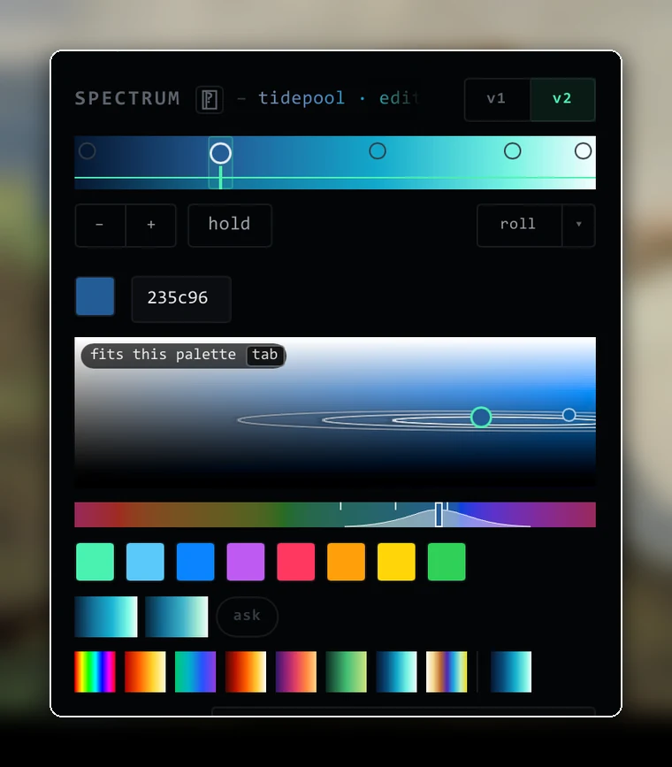
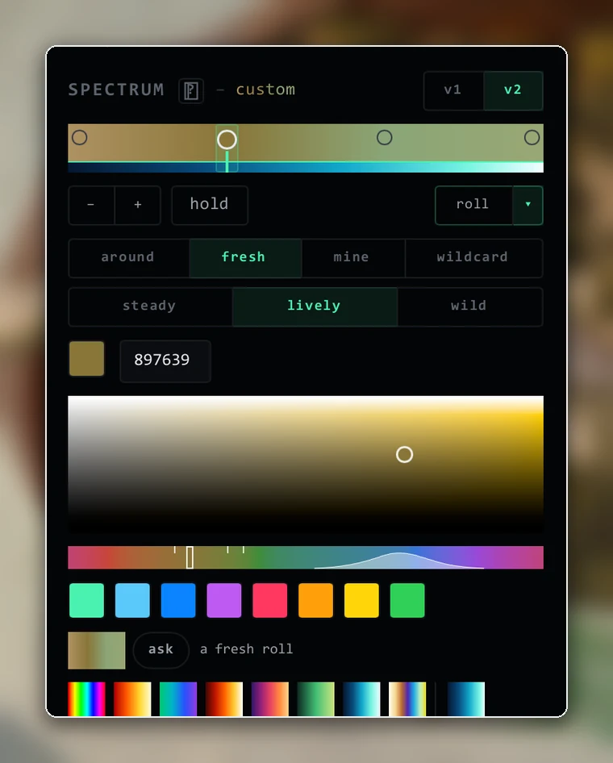

# Changelog

## Unreleased
Luma-T, a colour model that edits with you, and a round of fixes from everyday use.

### New
- **Luma-T.** A 662,635-parameter colour model ships with Neuron and runs on your computer in real time. It suggests colours for the stop you're editing, carries a change through the rest of the palette, tidies the stops around it and colours new stops.
- **Picker v2, now the default.** Lightness and vividness on a plane, hue on a rail, in an even colour space, so changing hue keeps the colour as light as it was. Suggestions are dots in the colour square and pills under the picker: point to try one on your lights, click to keep it, undo to go back. `v1` in the spectrum header switches back.
- **Ask and roll.** Ask brings ideas even when Luma-T would leave the palette alone (they're drawn faint). Roll makes a whole palette: around your held stops, fresh, like your other palettes, or pure chance, at three levels of wildness.
- **Keyboard picking.** Grab a stop and the keyboard drives the picker: arrows nudge, Tab shows the first idea and Tab again keeps it, Tab with a number picks another, R rolls, Ctrl+Z undoes.
- **It learns your taste.** What you keep and pass over shapes its suggestions as you go, on your computer only (`picker_journal = false` turns it off).
- **Its view at a glance.** A squiggle marks a stop Luma-T would change, and rings in the colour square and hills on the hue rail show where a colour belongs.
- **Fn and media keys in driver mode.** Keyboards held for their macro keys keep Fn combos and media keys; the BlackWidow Chroma V2's Fn row comes from its definition. New `game-mode` action.

### Better
- **Fast model answers.** 10 to 60 ms per edit, down from up to a second.
- **One live device registry.** Adopting or editing a device reaches every part of the app without a restart.
- **Sharper, steadier UI.** Pages sit on whole pixels so thin lines draw crisp, the stop keys are a compact `− │ +` that show what they'll do on the strip, and long names fade out instead of stopping mid-letter.
- **Roomier timeline.** `stay` runs to 30 s and `fade in` to 10 s; pairing pills fit their longest name.
- **Stricter UI checks.** Every frame the GUI tests draw is checked for cut text, unreachable controls, flicker and layout that doesn't fit, and any Slint warning fails the build.

### Fixed
- **Binds on keys a device can't remap itself** fire again, and a key several keyboards share goes to the one you typed on.
- **HyperShift** keys type normally unless the hold key is down.
- **Quitting with a sleeping wireless Naga** no longer hangs for up to a minute.
- **Arming after a sleeping device** retries instead of leaving input in safe mode all session.
- **Macro sidecars** are no longer killed when a busy machine delays their arming.
- **Hovering the roll button** no longer makes the window flicker, and a closing guide card no longer swallows the next click.
- **Shared device files** can't attach commands to keys a built-in definition doesn't ship.

## 0.1.7 · 2026-11-08
Locked-down macros and shared files, and fixes for keyboards people reported.

### New
- **Macro API reference** in `docs/reference/MACROS.md`.
- **More for BOUND macros.** `signal` and the OBS helpers work in BOUND mode; `obs_request` stays RAW-only.

### Better
- **BOUND macros are walled in.** File, process, network, native-library and new-module access is refused by any route, and BOUND ignores `PYTHONPATH`, `PYTHONHOME` and user site packages.
- **Imports ask before running code.** `neuron apply` and `profile import` list and refuse RAW macros, command binds, path screenshots and onboard-memory profiles unless you pass `--allow-code`.
- **Device files are bounded** by Neuron's protocol knowledge when they load; refused files are reported.
- **Safer helpers.** The Chroma REST server refuses non-loopback hosts, the updater verifies its source and the setup program's attestation, the bundled Python is pinned, and elevated helpers never load from user-writable folders.
- **Chroma broker updates** stage and verify the replacement before stopping the working copy, and restore it on failure.
- **Clearer helper results.** Effect helpers return `True` or a falsy reason in both macro modes.

### Fixed
- **BlackWidow V3 and V4 X lighting.** Generated definitions now target the whole board and the backlight; older files are rebuilt with a backup (#33, #23).
- **M keys on a keyboard adopted after startup** (#23).
- **Sleep and Modern Standby** no longer cause false stall warnings.
- **Quitting from the tray** no longer panics.
- **Macro odds and ends.** `datetime.strptime` works in BOUND macros, dry runs leave live lighting alone, and a slow parse no longer restarts Python.
- **`neuron apply`** rejects unknown sections and names what failed.

### Thanks
Thanks to @shinobun33t (#23) and @kurakanai (#32, #33) for testing Neuron on their keyboards and reporting what broke.

## 0.1.6 · 2026-10-16
Tagged but never published: everything here shipped in 0.1.7.

### New
- **Copy inventory.** `neuron-update.ps1 -Action status` (and `-Json`) tells apart the running repo build, the installed copy, the startup target and the config paths.

### Fixed
- **Lighting ownership** survives a host restart, and single-LED OpenRGB updates work after a surface resizes.
- **Macro keys** refresh after a keyboard is adopted, with held keys shared correctly across sibling devices.
- **Malformed replies** from Razer discovery and HID++ are rejected.
- **Copies and the broker are left alone.** Builds, installers and uninstall keep other copies' startup target and the shared Chroma broker; your configuration is never removed with the program.
- **Updates already current** skip the download and backup, and clean up after themselves.

## 0.1.5 · 2026-10-13
Lighting grows up: layers, gradients, pairings, and a lab for unknown hardware.

### New
- **Lighting layers.** An ordered stack with visibility, duplication, per-layer opacity and blends (Normal, Screen, Add, Multiply, Cutout), plus dissolves between looks.
- **Gradient presets.** Rainbow, fire, aurora, thermal, sunset, meadow, ice and bubble (a soap-film ramp from thin-film interference); one click swaps the stops and keeps motion and blend.
- **Suggested pairings.** A chip on each effect tile tries it with another gradient or mode, hand-picked ones first.
- **Compatibility Lab.** HID inventory, sanitized evidence bundles and issue drafts for hardware Neuron doesn't know yet; input trials need your consent.
- **Palette names in their own colours,** with an "edited" suffix when you change a stock ramp.

### Better
- **A more responsive editor.** Simulation, thumbnails and saved-effect files run off the UI thread, and offscreen tiles sleep.
- **A tighter inspector** with a colour-mix dropdown, reversible colour motion and inline property pickers.
- **Fire and Typing Heat** keep a dark foot on bright gradients, and Comet's light painting lingers about 30 s.

### Fixed
- **Ripple** keeps its waves during fast typing.
- **Animation timing.** Same-length effect swaps, Comet retriggering, Heat on repeated timestamps and the breathing loop's join.

## 0.1.4 · 2026-10-04
Controllers, Wildlife, and a CLI that can author everything.

### New
- **Controllers.** General controller input on Windows, stick-driven radial casting, Xbox-protocol pad haptics, device badges and sensor reads.
- **Wildlife,** a seasonal cellular lighting habitat shaped by your typing.
- **Clipboard tools.** Transforms, session history, screenshots, lighting-layer actions and session Undo.
- **A CLI for everything.** `neuron <noun> <verb>` with `--json`, validated writes, live reload of a running app, and the whole setup as one document.
- **Synapse 3 import** from its mapping logs.

### Better
- **Binds and lighting** got grouped action picking, inline controls, filtered bind lists and device identity in the preview.
- **Hardened by adversarial testing:** controller identity, Naga side-plate binds, clipboard formats, screenshots and nested actions.

## 0.1.3 · 2026-09-29
Games' lighting, understood.

### New
- **Chroma lab.** Splits a game's lighting into ambient, held keys, animated keys and recurring effects, with replay, hiding and a colour lens.
- **Game scenes and rules.** Notifications when a flagged scene ends in the background, and game-light rules for clips, OBS scenes, profiles and mute.
- **Game Light layer** carries a Chroma game's colours to any device.

### Better
- **Native Chroma decoding** rewritten per device type, with SDK preset effects and suspended games recognized.
- **One signal language** for colours and lamps; faders take typed values, reset and fine adjustment.

## 0.1.2 · 2026-09-26
Quieter, sturdier, safer.

### Better
- **Less idle work** in dispatch, capture, tray, audio, gestures and previews.
- **Renderer fallback** improved, with an opt-in WGPU renderer.
- **Windows lifecycle.** Autostart without administrator rights, automatic and recoverable Chroma setup, and config migrated forward.
- **Safe mode** starts with input disarmed and device writes paused.

### Fixed
- **Hardware replies and writes** hardened; intercepted keys release properly and sniper DPI restores on the right mouse.
- **Profile updates** are serialized across processes.

## 0.1.1 · 2026-09-20
### Fixed
- **Updates** found prereleases and downloaded from private repositories correctly.
- **Docs** for install, platforms, troubleshooting and macros.

## 0.1.0 · 2026-09-19
The first public beta.

### New
- **Neuron.** A Windows tray app and CLI for Razer device control, profiles, remaps, lighting, macros and audio, with input disarmed until you arm it and device writes verified by reading them back.
