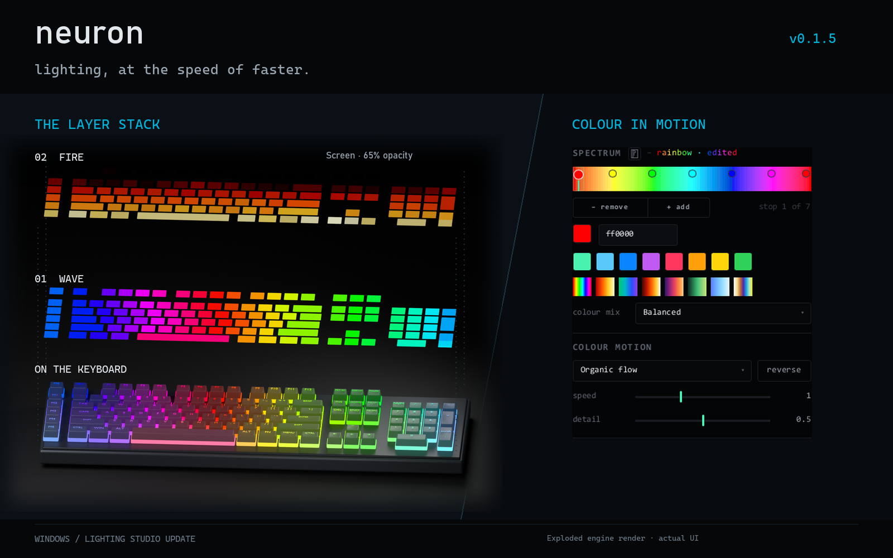
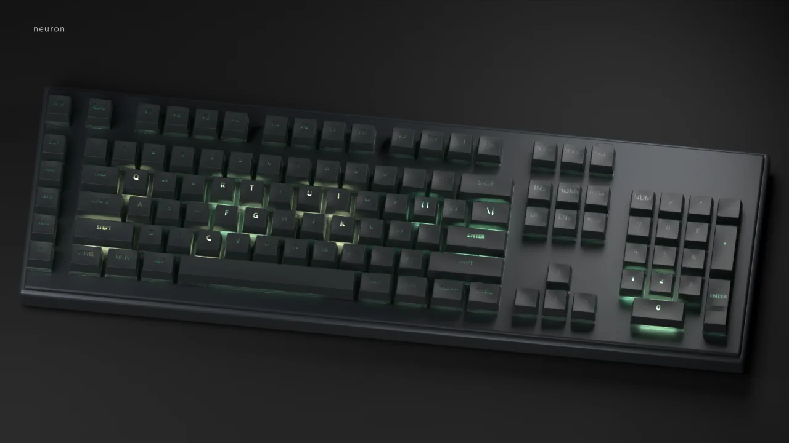

# changelog

## unreleased
the colour picker grew a brain: Luma-T, a tiny colour model that edits with you. plus a pile of fixes from living with neuron every day.

### new
- **Luma-T.** a 663k-parameter colour model that ships inside neuron and runs on your computer in real time, no GPU or internet. it suggests colours for the stop you're editing, carries a change through the rest of the palette, tidies the stops around it and colours new ones.
- **picker v2, now the default.** lightness and vividness on a plane, hue on a rail, in an even colour space, so turning the hue keeps the colour as light as it was. suggestions sit right where you'd pick: dots in the square, pills underneath. hover to try one on your lights, click to keep it. `v1` in the spectrum header if you miss the old one.
- **ask and roll.** ask gets you ideas even when Luma-T would rather leave your palette alone (they're drawn faint, because they're a stretch). roll makes a whole palette: around the stops you're holding, from scratch, like your other palettes, or pure chance.
- **drive it from the keyboard.** grab a stop and the arrows nudge it. Tab shows the first idea and Tab again keeps it, Tab with a number picks another, `R` rolls, `Ctrl+Z` takes it back.
- **it learns your taste.** what you keep and pass over shapes what it suggests next, on your machine and nowhere else. `picker_journal = false` turns it off.
- **see what it's thinking.** an amber squiggle marks a stop it would change. contour rings in the colour square and hills on the hue rail show where a colour would fit.
- **Fn keys survive driver mode.** keyboards neuron holds for their macro keys keep their Fn combos and media keys. the BlackWidow Chroma V2's Fn row comes from its definition, and there's a new `game-mode` action.

### better
- **Luma-T answers fast.** 10 to 60 ms per edit, down from up to a second.
- **devices update live.** adopt or edit a device and every part of the app sees it, no restart.
- **crisper UI.** pages sit on whole pixels so thin lines stop smearing, the stop keys shrank to `− │ +` and show on the strip what they're about to do, and long names fade out instead of stopping mid-letter.
- **longer timeline holds.** `stay` goes to 30 s and `fade in` to 10 s.
- **UI bugs get caught before you see them.** every frame the GUI tests draw is checked for cut-off text, dead buttons, flicker and layout that doesn't fit, and any Slint warning fails the build.

### fixed
- **binds on keys a device can't remap itself** fire again, and a key that several keyboards share goes to the one you actually typed on.
- **HyperShift** keys type normally unless you're holding the HyperShift key.
- **quitting with a sleeping wireless Naga** used to hang for up to a minute. it doesn't now.
- **a sleeping device at startup** no longer leaves input in safe mode all session; neuron retries and arms once it's back.
- **macros on a busy machine** no longer get killed for arming slowly.
- **the window flickered** when you hovered the roll button, and a closing guide card ate your next click. both gone.
- **shared device files** can't attach commands to keys a built-in definition doesn't have.

## 0.1.7 · 2026-11-08
a hardening pass. i went through neuron trying to break it and fixed what fell out: macros and shared setups locked down, and the keyboards you reported now light up properly.

### new
- **a macro API reference,** in `docs/reference/MACROS.md`.
- **more for BOUND macros.** `signal` and the OBS helpers work in BOUND mode. `obs_request` stays RAW-only.

### better
- **BOUND macros live in a box.** file, process, network, native-library and new-module access is refused by every route i know of, and BOUND ignores `PYTHONPATH`, `PYTHONHOME` and user site packages.
- **imports ask before they run code.** `neuron apply` and `profile import` list and refuse RAW macros, command binds, path screenshots and onboard-memory profiles unless you pass `--allow-code`.
- **device files have limits.** a definition can only use commands neuron knows; anything refused or unreadable is reported.
- **tighter helpers.** the Chroma REST server only answers requests addressed to this computer, the updater checks its source and the installer's attestation, the bundled Python is pinned, and elevated helpers never load from folders you can write to.
- **broker updates can't strand you.** the Chroma broker stages and checks its replacement before stopping the old one, and puts it back if anything fails.
- **macro helpers answer clearly.** effect helpers return `True`, or something falsy with the reason, in both modes.

### fixed
- **BlackWidow V3 and V4 X lighting.** generated definitions now cover the whole board and the backlight. older files get rebuilt, with a backup (#33, #23).
- **M keys on a keyboard plugged in after neuron started** (#23).
- **sleep and Modern Standby** no longer set off false stall warnings.
- **quitting from the tray** no longer crashes on the way out.
- **macro odds and ends.** `datetime.strptime` works in BOUND macros, dry runs leave your live lighting alone, and a slow parse doesn't restart Python anymore.
- **`neuron apply`** rejects sections it doesn't know and says which one failed.

### thanks
thanks to @shinobun33t (#23) and @kurakanai (#32, #33) for trying neuron on their keyboards and telling me what broke.

## 0.1.6 · 2026-10-16
tagged but never published. everything here went out in 0.1.7.

### new
- **see every copy at once.** `neuron-update.ps1 -Action status` (`-Json` for agents) tells apart the build you're running, the installed copy, what starts with Windows and where the config lives.

### fixed
- **lighting ownership** survives a host restart, and single-LED OpenRGB updates work after a surface resizes.
- **macro keys** pick up a keyboard adopted mid-session, with held keys tracked across its sibling devices.
- **malformed replies** from Razer discovery and HID++ get rejected instead of trusted.
- **other copies stay put.** builds, installers and uninstall leave other copies' startup target and the shared Chroma broker alone, and never take your config with them.
- **updates you already have** skip the download and backup, and clean up after themselves.

## 0.1.5 · 2026-10-13
a much faster lighting page. then it kept going: layers, gradients, pairings, and a lab for hardware neuron doesn't know yet.

### new
- **lighting layers.** an ordered stack with visibility, duplicates, per-layer opacity and blends (normal, screen, add, multiply, cutout), and dissolves between looks.
- **gradient presets.** rainbow, fire, aurora, thermal, sunset, meadow, ice and bubble (a soap-film ramp from actual thin-film interference). one click swaps the colours and keeps your motion and blend.
- **suggested pairings.** a chip on each effect tile tries it with another gradient or mode. my favourites first, the rest scored.
- **Compatibility Lab.** HID inventory, cleaned-up evidence bundles and issue drafts for unknown hardware. input trials only run with your say-so.
- **palette names in their own colours,** with an "edited" tag once you change a stock one.

### better
- **a snappier editor.** simulation, thumbnails and saved effects run off the UI thread, and tiles you can't see go to sleep.
- **a tighter inspector,** with a colour-mix dropdown, reversible colour motion and inline property pickers.
- **Fire and Typing Heat** keep a dark foot on bright gradients, and Comet's light painting now lingers about 30 s.

### fixed
- **Ripple** keeps its waves when you type fast.
- **animation timing:** effect swaps, Comet retriggering, Heat on repeated timestamps and the breathing loop's seam.

## 0.1.4 · 2026-10-04
more intentional UI, general controllers, and a little wildlife on your keyboard.

### new
- **controllers.** general controller input on Windows, radial casting with a stick, Xbox-protocol pad rumble, device badges and sensor reads.
- **Wildlife,** a seasonal lighting habitat that lives off your typing.
- **clipboard tools.** transforms, session history, screenshots, lighting-layer actions and session undo.
- **a CLI for everything.** `neuron <noun> <verb>` with `--json`, writes that check themselves, live reload of a running app, and your whole setup as one document.
- **Synapse 3 import,** from its mapping logs.

### better
- **binds and lighting** got grouped action picking, inline controls, filtered bind lists and device identity in the preview.
- **hardened by trying to break it:** controller identity, Naga side-plate binds, clipboard formats, screenshots and nested actions.

## 0.1.3 · 2026-09-29
games' lighting, picked apart. Overwatch paints a lot onto your keys; now you can see what each part of it is.

### new
- **Chroma lab.** splits a game's lighting into ambient, held keys, animated keys and repeating effects, with replay, hiding and a colour lens.
- **game scenes and rules.** a heads-up when a flagged scene ends while the game's in the background, plus rules that fire a clip, OBS scene, profile or mute.
- **Game Light,** a layer that carries a Chroma game's colours to any device.

### better
- **native Chroma decoding,** rewritten per device type, with SDK preset effects and suspended games recognised.
- **one signal language** for colours and lamps. faders take typed values, reset and fine adjustment.

## 0.1.2 · 2026-09-26
quieter in the tray. neuron lives there, so it shouldn't be busy while nothing's happening.

### better
- **less idle work** in dispatch, capture, the tray, audio, gestures and previews.
- **renderer fallback** got smarter, and there's an opt-in WGPU renderer.
- **the Windows lifecycle.** autostart without admin, Chroma setup that sets itself up and recovers, and your 0.1.1 config carried forward.
- **safe mode** starts with input disarmed and device writes paused.

### fixed
- **hardware replies and writes,** hardened. intercepted keys let go properly and sniper DPI comes back on the right mouse.
- **profile updates** no longer trip over each other across processes.

## 0.1.1 · 2026-09-20
Windows beta. the updater finds beta releases, and the docs got shorter and truer.

### fixed
- **updates** find prereleases and download from private repositories.
- **the docs** for install, platforms, troubleshooting and macros.

## 0.1.0 · 2026-09-19
beta mk1. the first public one.

### new
- **neuron.** a Windows tray app and CLI for Razer device control, profiles, remaps, lighting, macros and audio. input stays disarmed until you arm it, and every device write is checked by reading it back.
