# neuron

**your razer hardware. your rules.**

neuron is my replacement for Razer Synapse: a free Windows app and CLI for DPI, polling, lighting, profiles and button remapping. i reverse-engineered how Synapse talks to my Razer hardware and built my own controls in Rust. no account, cloud sync, telemetry, extra kernel driver or vendor SDK.

i don't run Synapse anymore. neuron handles my Naga V2 Pro and BlackWidow Chroma V2 every day. if something's missing, i build it in.

**more than a replacement.** layered reactive lighting, Python macros, app-aware binds, radial menus and gesture controls. it's the Synapse stuff i needed, plus the things i always wanted.

**a control layer built to grow beyond Razer.** gamepads already feed the same action engine; the hardware layer can grow to other vendors. Razer mouse and keyboard controls are still the focus for now. [here's what actually works](docs/STATUS.md).

**[download for Windows](https://github.com/worflor/neuron/releases/latest)** · [FAQ & manual help](docs/FAQ.md) · [check device support](docs/STATUS.md) · [help test yours](#help-neuron-on-your-hardware)

<p align="center">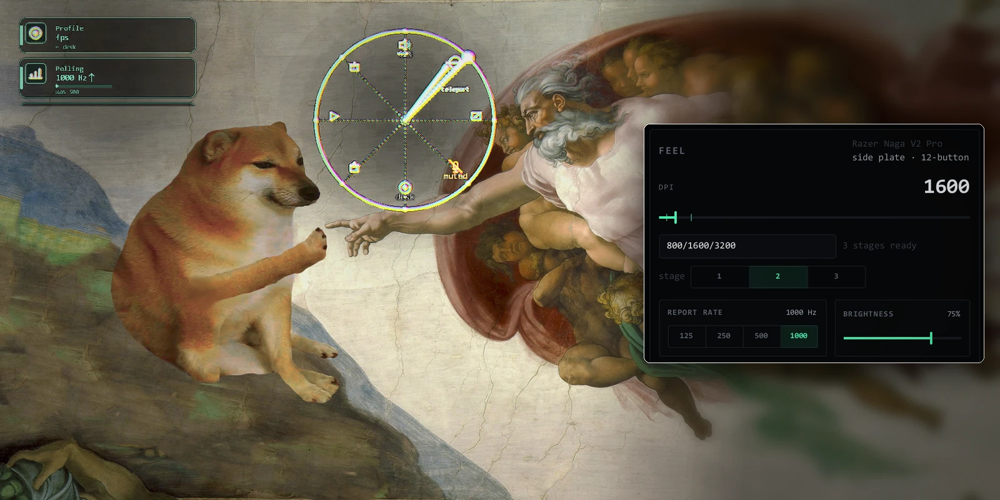</p>

| | |
|---|---|
| **status** | Windows beta; daily-driven on the Naga V2 Pro and BlackWidow Chroma V2. Other Razer devices need their own testing |
| **platforms** | Windows 10/11 download. Linux app and CLI build from source, but Razer hardware control is unverified there; macOS has no backend yet |
| **under the hood** | shared trigger → action engine; read-back checks for supported settings; an [evidence ledger](crates/neuron-core/protocol/ledger.toml) for the hardware protocol |
| **license** | mostly GPL-3.0-or-later with an exception; some research components have separate community-source terms. [details](LICENSE.md) |

---

## contents

- [why this exists](#why-this-exists)
- [the idea: `trigger → action`](#the-idea-trigger--action)
- [what it does](#what-it-does)
- [won't surprise you](#wont-surprise-you)
- [get it](#get-it)
- [help test your hardware](#help-neuron-on-your-hardware) · [contributing](#contributing)
- [honesty: proven, gated, absent](#honesty-proven-gated-absent)
- [philosophy / non-goals](#philosophy--non-goals)

the full feature depth — every subsystem, up close — lives in
**[the feature design doc](docs/GDD.md)**. how it's built is
**[the technical design doc](docs/TDD.md)**. what actually works today, graded
honestly, is **[state of the project](docs/STATUS.md)**.

---

## why this exists

i've been through Synapse 1, 2, 3... and then 4 showed up and wanted to tell me when to update my mouse software. i said nuh uh. i like my Razer hardware. i just got tired of what came with controlling it.

i wanted the basic stuff to work without an account, background clutter or having to fight a settings app. then i wanted better lighting. then i wanted to cast spells with my mouse. you can probably see where this went :P

so neuron has a few rules:

- **stay local.** no Neuron account, telemetry or cloud sync. settings are plain TOML files you can read and keep.
- **don't fight the user.** one resident app, one shared action engine. change what you asked for, not three other settings on the way.
- **don't guess at hardware.** settings with getters are checked against the device; live lighting checks its protocol replies. unverified writes stay gated.
- **more, never bloat.** extra features are welcome when they earn their place. another mandatory background service isn't.

neuron isn't a one-for-one Synapse clone. it's the replacement i use, with room for things Synapse was never going to do.


## the idea: `trigger → action`

everything in neuron is **one primitive**. *something happened* (a `Trigger`) so *do this* (an `Action`). that's the magic. a button press, a drawn glyph, a radial flick, the foreground app changing, a tap on your mic, a held hypershift layer are all `Trigger`s; a keystroke, a macro, a dpi cycle, a profile switch, a python script, "teleport to the other monitor" are all `Action`s.

that isn't a description of the architecture, it's the reason the thing is worth building. because a drawn glyph and a button press are *the same kind of event*, anything you can bind to one you can bind to the other, and a new input source doesn't need a new pipeline to hang off. there is exactly one dispatch engine in here.

**press-to-bind anything and everything**: don't like my setup? make it yours.

<p align="center">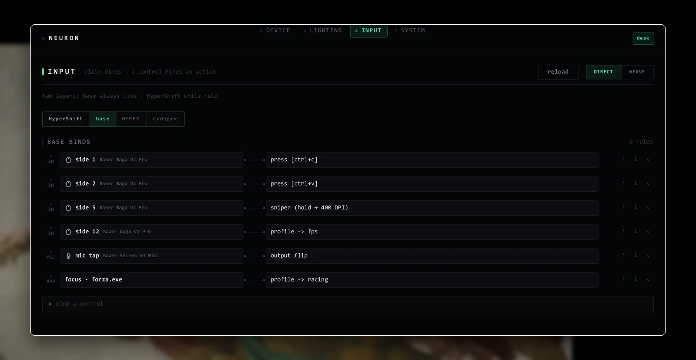</p>

<p align="center">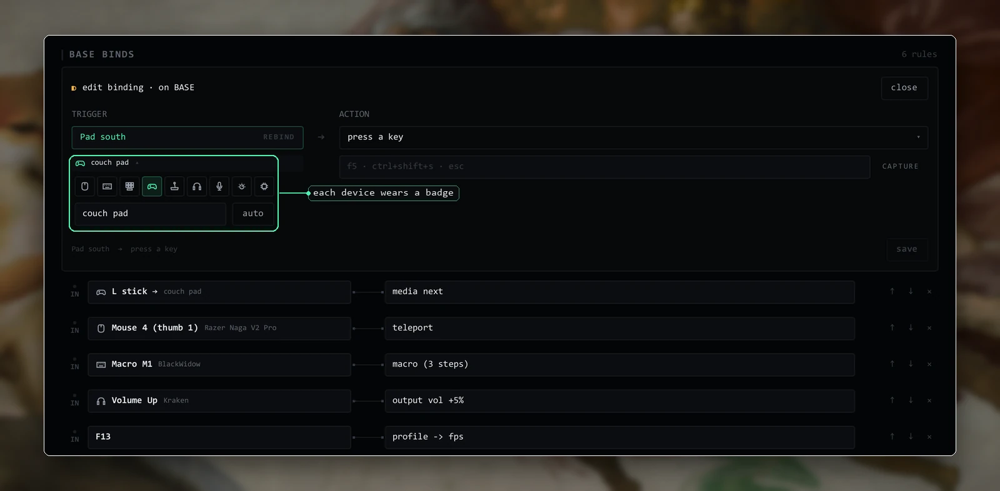</p>

<table>
<tr>
<td width="50%"></td>
<td width="50%"></td>
</tr>
</table>

[the full trigger and action tables →](docs/GDD.md#the-idea-trigger--action)

## what it does

the short tour. each line links into [the feature doc](docs/GDD.md), which has the real depth.

<p align="center">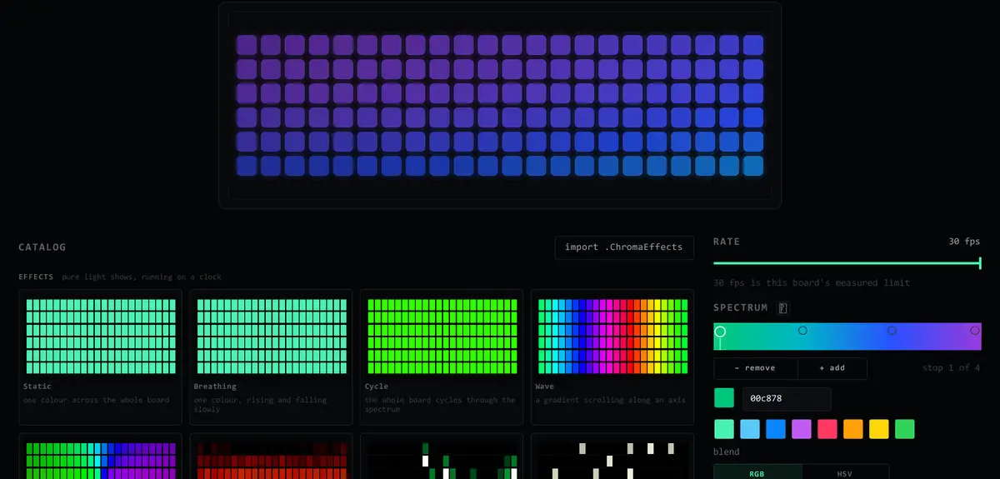</p>

<table>
<tr>
<td width="50%">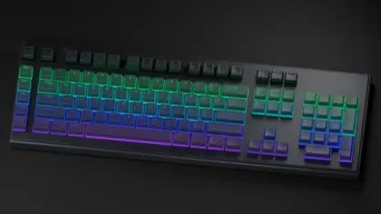<br><sub><b>fire</b> in aurora</sub></td>
<td width="50%">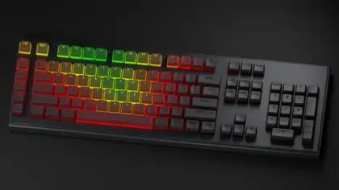<br><sub><b>typing heat</b> in rainbow, a sentence being typed</sub></td>
</tr>
<tr>
<td width="50%">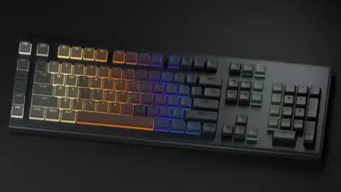<br><sub><b>ripple</b> in bubble</sub></td>
<td width="50%">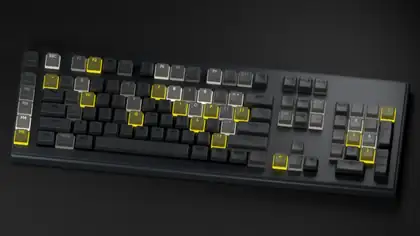<br><sub><b>cascade</b> in matrix mode, in bubble</sub></td>
</tr>
</table>

<p align="center"><sub>each is one chip on its tile. these are neuron's own pattern-engine frames on a generic keyboard model rendered in Blender, not a photo; the optics are an estimate.</sub></p>

<p align="center">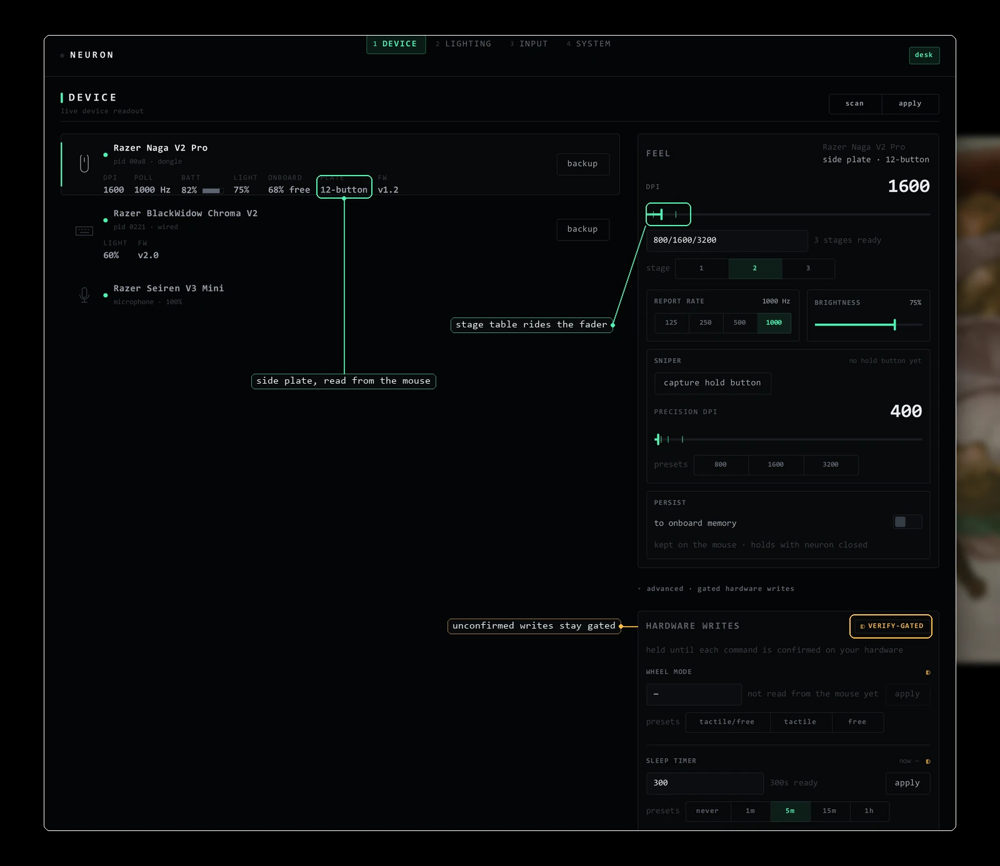</p>

| | |
|---|---|
| **[device control](docs/GDD.md#talks-to-your-gear)** | DPI and stage cycles, polling, brightness, scroll stages, lift-off, battery and idle settings on supported hardware. no Synapse needed. |
| **[lighting](docs/GDD.md#lighting)** | layer effects, gradients, blends and typing reactions. paint per-key lighting, use live system data, and fade between looks instead of resetting everything. |
| **[buttons & profiles](docs/GDD.md#the-spine)** | remap supported controls, use HyperShift and Naga side-plate layers, and switch profiles automatically for different apps. |
| **[spellweaving & radial](docs/GDD.md#spellweaving)** | draw a glyph or flick a wheel to trigger the same actions as a button. teleport windows, summon tools, even draw on your screen. |
| **[macros & beacons](docs/GDD.md#macros--beacons)** | Python macros, a visual block editor, persistent state and on-screen questions from your scripts. BOUND by default, RAW when you want full Python. |
| **[audio & other actions](docs/reference/CLI.md#triggers-and-actions)** | bind mic mute/gain, output switching, clipboard transforms, screenshots, undo and window actions to your controls. |
| **[games & RGB tools](docs/reference/PROTOCOL-HOST.md)** | opt-in Chroma and OpenRGB connections let games paint through Neuron alongside your own lighting. early, and still being tested across games. |
| **[life after Synapse](docs/GDD.md#life-after-synapse)** | import supported Synapse exports, clean up its Windows services, and investigate unfamiliar devices. |
| **[gamepads](docs/GDD.md#controllers-and-anything-else-with-buttons)** | buttons, sticks and triggers can become binds. aim the radial with a stick and use rumble where it's been verified on Windows. |
| **[app & CLI](docs/reference/CLI.md)** | use the app to set things up, or the CLI to change the same settings by hand. configs stay on disk as plain TOML. |

<p align="center">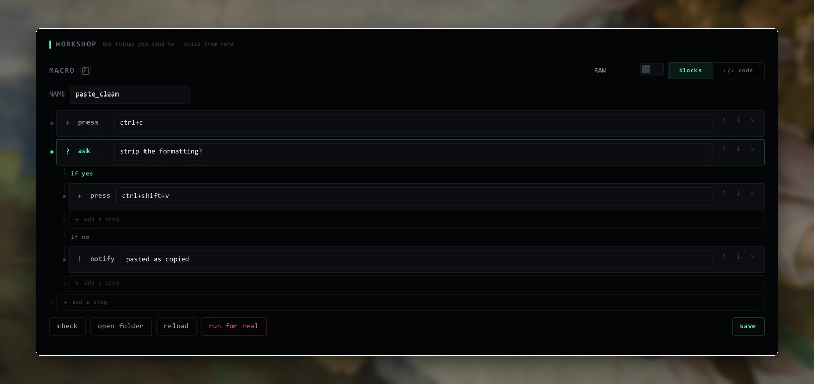</p>

<p align="center">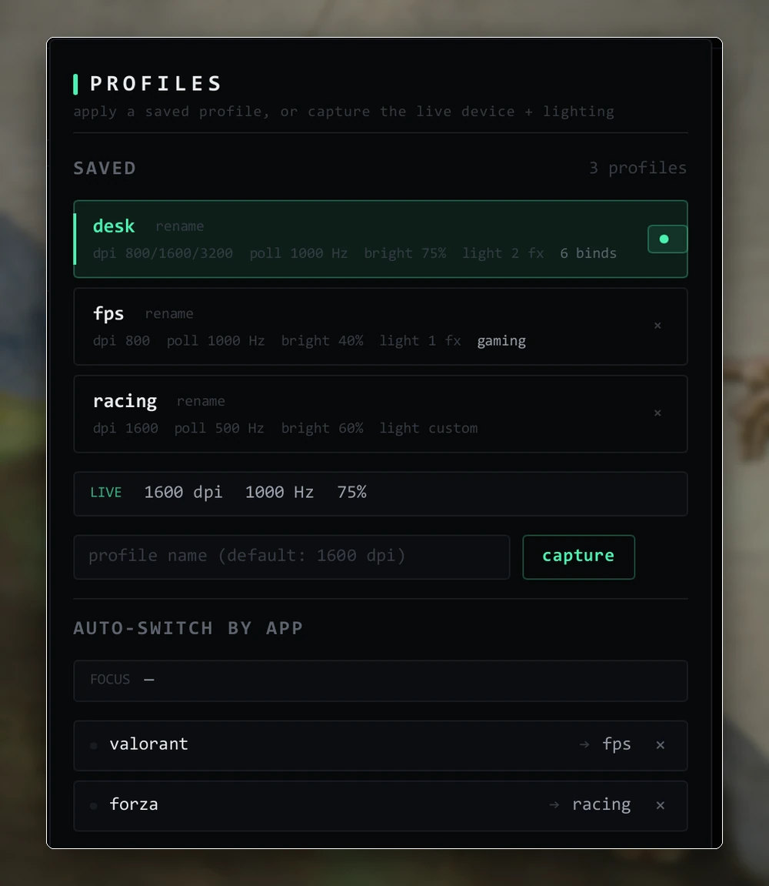</p>

## won't surprise you

neuron can change hardware settings, send input and run Python. the boring safety stuff matters.

<table>
<tr>
<td width="42%">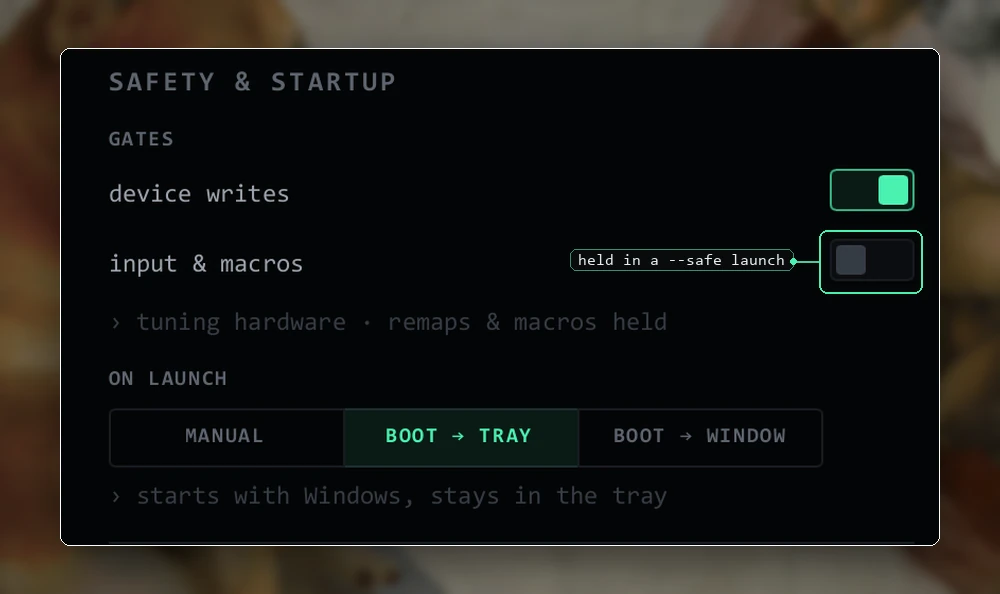</td>
<td width="58%"></td>
</tr>
</table>

- **[input has a switch](docs/GDD.md#the-arm-gate).** a normal Windows launch arms live binds when the input engine starts. `--safe` keeps input disarmed and device writes paused. disarming is instant; turning input back on manually asks first. tests can't arm real input.
- **[hardware changes get checked](docs/GDD.md#writes-that-verify-themselves).** settings like DPI and polling read back what the device accepted. writes without enough evidence stay gated or are explicitly flagged in the evidence ledger. live lighting frames use checked protocol replies rather than pretending every LED update has a matching getter.
- **[notifications are yours](docs/GDD.md#confirmations).** on-screen cards tell you when supported changes land. move them, quiet them, or turn them off entirely.

and yes, Neuron can run full Python if you choose RAW macros. that's your computer's authority, not a sandbox. [here's the actual security model](SECURITY.md).

## get it

**Windows 10/11 (x86_64): [download the latest release](https://github.com/worflor/neuron/releases/latest).** Grab the installer for a normal setup, or the portable ZIP if you'd rather unpack it yourself. Both have the app and CLI. Run `neuron-app.exe` from the portable ZIP.

Windows may warn about the unsigned build. The release includes `SHA256SUMS.txt`, and `SOURCE.txt` tells you what source commit the binaries came from. [install and build details](#build).

> **steam at 50 stars.** if this repo hits 50 stars, i'll put neuron on Steam for easier updates. It'll still be free and available on GitHub. this would just be another way to get it :P

### just use it

open neuron from Start, or run `neuron-app.exe` from the portable folder. DEVICE handles hardware settings, LIGHTING builds your effects, and INPUT is for buttons and gestures. profiles are in the header; SYSTEM has diagnostics and the safety switches. no terminal needed.

the [FAQ](docs/FAQ.md) covers installing, updating, profiles, macros and troubleshooting. want to do more by hand? the [CLI reference](docs/reference/CLI.md) covers the same engine, including backups and compatibility tools.

<details>
<summary><b>optional: using a coding agent</b></summary>

if you already use OpenCode, Claude Code or something similar, Neuron includes [setup and update](skills/neuron-lazy-update/SKILL.md), [CLI configuration](skills/neuron-cli/SKILL.md), [macros](skills/neuron-macros/SKILL.md) and [compatibility research](skills/neuron-compat/SKILL.md) skills. they're a shortcut for workflows you can also do yourself. check any device changes and review evidence before sharing it.

</details>

### build

windows packages provide an installer and portable zip, each with the app and CLI. both include the license bundle, the agent skills, and a `SOURCE.txt` naming the source commit and build method. linux packaging is deferred; the source still builds there.

the windows builds are **not code-signed**. windows SmartScreen may warn on first run. check `SHA256SUMS.txt` against the downloaded installer or zip, then read the packaged `SOURCE.txt` for the exact commit and build method. github-built artifacts may also carry a provenance attestation; locally built artifacts do not. when an attestation is attached, verify it with:

```
gh attestation verify neuron-<version>-windows-x86_64.zip --repo worflor/neuron
```

The `open / run` action uses the existing shell helper. A Windows URL example is
`start "" "https://example.com"`; a bare URL is not a shell command. Shell scripts use that
same helper, while Python macros alone use the warm Macro Host.

the installer places neuron in `%LOCALAPPDATA%\Programs\Neuron` and adds a Start menu shortcut. the zip stays portable: extract it anywhere writable and run `neuron-app.exe`.

windows packages include the native Chroma broker. Windows Setup provisions it before
replacing app files after one elevation prompt; declining cancels without leaving a partial
installer-managed update. the portable updater provisions it automatically after copying the
app, and a manually extracted portable copy asks when Connections first needs it. the tray and
macros stay at limited privilege. repeat installs do not prompt again while the protected broker
already matches the package.
Chroma REST and OpenRGB work without elevation.

```
cargo build --release      # -> target/release/neuron.exe (CLI) + neuron-app.exe (GUI)
.\validate.ps1             # the gates: the suite, disarmed. the same ones CI runs.
```

if the window cannot open on a VM, remote desktop, or an older graphics driver, launch the app with `NEURON_RENDERER=software`. that selects Slint's software UI renderer for that run; it does not change device control or the Windows overlay instruments.

### where your config lives

both binaries resolve every runtime path against one **run root**, so the tray app (autostarted from `System32`) and a CLI you type from anywhere read the same config. it is never the working directory. the same three rules decide it on both platforms:

- **the binary's own folder** when the release archive carries `portable.flag`. this is the portable layout: copy the folder, keep your setup.
- **the per-user data dir** for installer and source builds — `%LOCALAPPDATA%\neuron` on windows, `$XDG_DATA_HOME/neuron` (usually `~/.local/share/neuron`) on linux. config stays across installer upgrades and out of `target/`, where one `cargo clean` would destroy it.
- **`NEURON_RUN_DIR`** whenever you set it, which wins over both. pin it if you want your config somewhere specific.

a symlink on your `PATH` doesn't change any of this: the binary resolves its real location, so a marked portable copy stays portable and `~/.local/bin/neuron` is safe.

upgrading from v0.1.1's Windows installer, or from a build that kept config in `target/release`? the first launch carries the old beside-the-executable config forward and prints where it went. it copies rather than moves, so the old folder stays put as a backup. if that copy fails, neuron reports the error and stops before using partial config; the next launch retries.

the normal `--release` build is tuned for snappy runtime (ThinLTO, stripped). use `--profile release-size` if you want it small, `--profile release-fast` if you want it quick, and `RUSTFLAGS="-C target-cpu=native"` outside the repo for native codegen. we keep cargo's default `unwind` (not `abort`), deliberately (see the comment in `Cargo.toml`): cleanup still runs when something panics, so the app never leaves your gear in a state you didn't ask for. every panic gets logged.

### the CLI

two binaries: `neuron` (the CLI) and `neuron-app` (the GUI). the stuff you'll actually type:

```
neuron list                          recognized devices
neuron feel dpi 1600                 set DPI (read-back verified)
neuron feel stages 800 1600 3200     set the DPI cycle (the whole table)
neuron lighting effect fire          dry-run the exact bytes per device
neuron lighting mirror               paint one device's vitals onto another's LEDs
neuron backup                        snapshot every device's full state
neuron import prof.synapse3 --apply  eat a synapse export
neuron run                           the remap daemon (esc to stop; --safe = observe only)
neuron macro add lift my.py          register a python macro
neuron macro prelude                 the `neuron` module reference (ctx + helpers + ask/notify)
```

<details>
<summary><b>the full command tree</b> (every subcommand takes <code>--help</code>)</summary>

`neuron <noun> <verb>`, with `--json` on everything. the full reference is **[docs/reference/CLI.md](docs/reference/CLI.md)**; an agent driving it reads **[skills/neuron-cli](skills/neuron-cli/SKILL.md)**.

```
devices   list · info · battery · adopt · storage · mode · backup · verify · badge · button
feel      feel (show · timing · sniper · dpi · polling · stages · scroll · lod · brightness ·
          game-mode · idle)
input     bind · control · action · trigger · cast · gesture · radial · macro · pocket ·
          run [--safe] · watch · pads · rumble · audio · twin
lighting  lighting (catalog · stack · fps · apply · effect · …)
setup     profile · config · dump · apply · reload · status · catalog · import
gui       neuron-app  [--safe · --tray · --purge-synapse · --scan-synapse]
```

</details>

Clipboard tools live on the same Trigger → Action path: ordered bounded text transforms,
full-format pockets, in-session displaced-state history, and screen/window/region screenshots.
`neuron pocket --help` lists pocket management and history commands; `neuron action list` shows the
typed action forms.

## help neuron on your hardware

i can't own every Razer mouse and keyboard. if you try neuron on yours, tell me what works, what doesn't, and whether you're using it wired, through a dongle or over Bluetooth. even a partial result is useful. [file a device report](https://github.com/worflor/neuron/issues/new?template=device_report.yml).

want to dig deeper? [Compatibility Lab](docs/reference/COMPATIBILITY-LAB.md#try-it-yourself) has read-only CLI steps to inspect your device and export a reviewable report. nothing uploads automatically, and identifying a device isn't proof its controls work. the optional [`neuron-compat` skill](skills/neuron-compat/SKILL.md) can guide the same steps.

## contributing

want to write code or design an effect instead? there's plenty to pick up without learning the whole tree. [CONTRIBUTING.md](CONTRIBUTING.md) has the device work, lighting patterns, presets, protocol adapters and larger ports, with the groundwork for each spelled out. [neuron · orbit](https://github.com/users/worflor/projects/1) is the issue board; anything in *Up for grabs* is ready to claim.

new to the tree? [AGENTS.md](AGENTS.md) is the quick orientation. tests can't arm input, and unknown hardware commands don't get a free pass. those rules aren't negotiable.

### the legal bit

most changes land under GPL-3.0-or-later with the Neuron-Woflo exception. [Engram](https://github.com/worflor/engram) and three reusable codec/eigenmotion modules keep their Woflo Labs community-source terms because they're research components rather than neuron-specific application code. [the license file](LICENSE.md) shows the exact four paths and how the combined build works.

what you write stays yours. the checkbox on a pull request gives Woflo Labs enough permission to ship, maintain, relicense, and commercially license an accepted contribution, with a promise that work accepted into the public project stays available in source form under a public project license. the full agreement is [here](LICENSES/CONTRIBUTOR-AGREEMENT-1.0.md); if an employer or client might own your work, please clear it with them before sending it.

## honesty: proven, gated, absent

[the full status page](docs/STATUS.md) tracks feature maturity and hardware testing. this is the device-control evidence, including things i haven't verified yet.

Linux builds from source but still needs native Razer hardware testing. [OpenRazer](https://github.com/openrazer/openrazer) is the mature Linux option for now; [OpenRGB](https://openrgb.org) covers broader RGB hardware. Neuron's Logitech HID++ discovery remains experimental and read-only.

what's proven, what's gated, and what's still missing:

| capability | status |
|---|---|
| reads: dpi, battery, polling, brightness, storage, lighting state | **proven** on hardware |
| dpi · polling · lighting settings | **proven** on named hardware; setters with paired getters read back the result. live lighting frames validate protocol replies |
| brightness write | **proven**: matrix and legacy setters read back the same varstore and LED region; live round-trip checked on the Naga V2 Pro and BlackWidow Chroma V2 |
| dpi-stage table · scroll-stage select | **wire-confirmed** off synapse (USBPcap) + round-tripped |
| symmetric lift-off distance | **proven**: reads back clean on the Naga |
| asymmetric lift-off distance (split lift/landing) | **proven**: set/read round-trip on the Naga (the `0x0B/0x85` getter echoes mode=async + the lift/landing pair; the physical split confirmed by feel) |
| idle/sleep timer | **proven**: set/read round-trip on the naga (write echoes back on the getter); behind the `idle-power-write` feature, which both shipped binaries turn on (a bare `neuron-core` library build leaves it off) |
| thumb-grid binds in firmware (`02/0C`) | **proven** live on the Naga V2 Pro: read back through `02/8C`, and the pressed key emitted the bound one. volatile direct profile, **normal mode only**, re-applied by neuron on connect and wake (`neuron button plan` / `apply` from the CLI). `15/02` reads back but does not change what a key emits, so nothing uses it any more |
| in-game hi-res polling · scroll *stage* table · snap-tap (SOCD) | **gated** behind `NEURON_*_WRITE` until a capture confirms; payloads unit-tested, still read-back-verified |
| debounce | **no known opcode**: bails with a "needs RE" note, never a blind write |
| saving binds into an onboard slot | **known, unused**: `02/0C` with profile 1-5 persists across power cycles per naga-companion; neuron keeps binds volatile |

things it flat-out doesn't do, so you know before you install:

- **doesn't crack synapse's encrypted cloud profiles.** the AES'd account cache is the lock-in, and we don't touch it. the plaintext in-app *export* is what migration can read.
- **doesn't pretend CPython is a hostile-code sandbox.** BOUND is the safer default capability tier, not an adversarial isolation promise. RAW remains full unsandboxed Python one explicit source line away; if you choose RAW, it can do anything your user account can.
- **no telemetry, no account, no cloud.**

## philosophy / non-goals

- no cloud. no account. no telemetry. ever.
- do what's asked, change nothing else.
- the device's own numbers are the truth: no weird filters or translations.
- novelty done well (spellweaving, radial, the open effects engine) is the fun. reheated gimmicks are not, and won't be added.
- lean is a feature. every background cost has to earn itself.
- more than synapse is fine; bloat is not. every extra thing here is deliberate and low-level, or it doesn't ship.
- started on my desk. i'm building the tools to make it work on more of yours, one verified device at a time.
- when neuron doesn't know something about your hardware, it says so instead of guessing.

built from first principles because the alternative is a 2GB login screen for a mouse.
